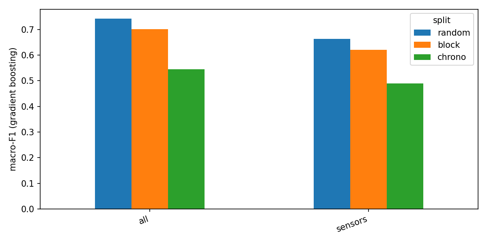

# NO₂ level prediction: how the evaluation protocol changes the conclusions

A small study on the UCI Air Quality dataset. A model that looks good on randomly
held-out hours performs much worse on later months, and its errors change character.
The repository contains the code behind that comparison.

## Task

Predict the **NO₂ concentration level** (`NO2(GT)`), discretised into five
equal-frequency classes, from the other sensors and weather variables. This is
not the Air Quality Index. Class edges are computed on the training part only.

Two kinds of inputs exist in the data:

- **Reference analyzers** (`CO(GT)`, `C6H6(GT)`, `NOx(GT)`): expensive, accurate measurements.
- **Low-cost sensors and weather** (`PT08.S1…S5`, `T`, `RH`, `AH`): the realistic input
  for a cheap monitoring device.

## What is compared

| Dimension | Options |
|---|---|
| Split | `random` hours · `block` (random whole weeks) · `chrono` (last 20% of the timeline is the test set) |
| Features | `all` · `all_rawtime` (+ raw hour/day) · `all_time_lags` (+ cyclical time + lags) · `sensors` (no reference analyzers) · `sensors_time_lags` |
| Models | feedforward network (128-64-32), with (`mlp_reg`) and without (`mlp_plain`) BatchNorm + Dropout · gradient boosting classifier (`hgb_clf`) · gradient boosting regressor with predictions binned into classes (`hgb_reg`) |

Preprocessing (median imputation, standard scaling) is fitted on the training part
only. `-200` marks missing readings. Lag features (previous hour, mean of the previous
three hours) use past values only.

Metrics: accuracy, macro-F1, share of predictions within one class, mean class
distance, share of errors falling between neighbouring classes, and share of errors
that under-predict.

## Findings

Macro-F1, mean over 2 seeds (`python run_experiments.py --quick`). The `chrono`
split is a single fixed split.

| Model | Features | random | block | chrono |
|---|---|---|---|---|
| gradient boosting | all | 0.742 | 0.700 | 0.544 |
| gradient boosting | sensors | 0.662 | 0.620 | 0.490 |
| neural network | all | 0.722 | 0.643 | 0.465 |
| neural network | sensors | 0.650 | 0.605 | 0.456 |

1. **A random split over-estimates performance.** Moving from random hours to random
   weeks costs 0.04–0.08 macro-F1, which I attribute to dependence between neighbouring
   hours. Moving on to the chronological split costs a further 0.13–0.18, which I
   attribute to the data changing over time. The cause (season or sensor drift) was not
   tested, and the chronological test period also has a different class mix.
2. **Errors change character.** On the random split roughly half of the errors
   under-predict; on the chronological split 80–94% do, for both models. The test
   period has about 53% of its samples in the top class (against 20% in training).
3. **Most errors are between neighbouring classes.** On the random split with all
   features, about 95% of errors fall between adjacent classes and 98–99% of predictions
   are within one class (about 88% adjacent with sensors only).
4. **One reference measurement dominates.** For gradient boosting with all features,
   shuffling `NOx(GT)` drops macro-F1 by about 0.28 on the chronological test set,
   against 0.04 or less for every other feature. NOx includes NO₂, so the `sensors`
   setting is the more meaningful one: it is 0.07–0.08 lower under a random split. With
   sensors only, `PT08.S2(NMHC)` matters most (0.17).
5. **Gradient boosting matched or beat the neural network** in all six comparisons,
   by more under the chronological split.




## Limitations

- Two seeds; neural-network results on the `block` split are noisy (std up to 0.07).
- The chronological split has a single test period, so gradient boosting has no
  standard deviation there.
- The cause of the shift over time is a hypothesis.
- Permutation importance was computed for gradient boosting only, and features are correlated.
- Keras `validation_split` uses the last 20% of the training rows: random rows on the
  random split, the latest part of the training period on `block` and `chrono`.
- Neural-network results are not bit-for-bit reproducible across machines.
- One dataset, one site, about one year of hourly data.

## Run it

```bash
pip install -r requirements.txt
# download AirQualityUCI.csv into data/ (see data/README.md)

python run_experiments.py --quick                    # lighter run
python run_experiments.py --models hgb_clf hgb_reg   # gradient boosting only, no TensorFlow
python run_experiments.py --seeds 5                  # fuller run
```

The neural-network runs are the slow part. To keep CPU use down on a laptop, limit
threads first, e.g. `OMP_NUM_THREADS=2 python run_experiments.py --quick`
(on Windows: `set OMP_NUM_THREADS=2`).

Outputs are written to `results/`: `runs.csv` (every run), `summary.csv` (mean and
standard deviation over seeds), confusion matrices and per-class reports,
permutation importance (CSV and figures), and `macro_f1_by_split.png`.

## Layout

```
no2_pipeline.py     data loading, features, splits, models, metrics
run_experiments.py  experiment grid, diagnostics, figures
data/               put AirQualityUCI.csv here (not committed)
results/            generated outputs
```
