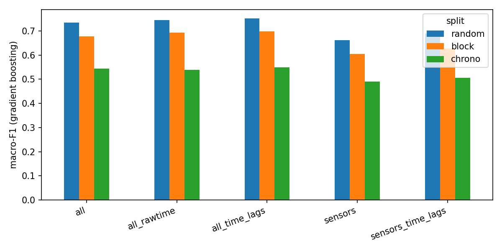
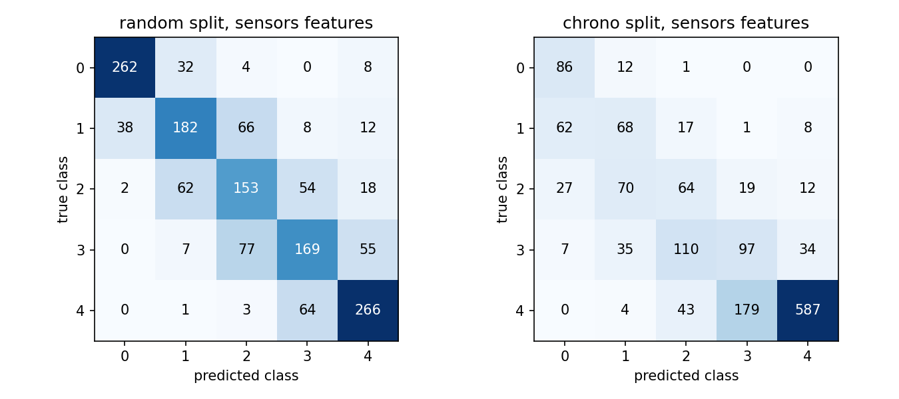

# Predicting NO₂ levels: how the train/test split changes the results

This is a small project on the UCI Air Quality dataset. The data are hourly sensor
readings, so rows that are next to each other are very similar. I wanted to see how
much the way I split the data into training and test sets changes the scores, and what
happens to the errors.

## Task

The dataset has 7,715 labelled hourly rows, from 2004-03-10 to 2005-04-04. I predict
the level of NO₂ (column `NO2(GT)`) from the other columns. The level is cut into five
classes with the same number of samples in each. The class edges are computed on the
training part only. This is not the Air Quality Index.

The other columns are of two kinds. `CO(GT)`, `C6H6(GT)` and `NOx(GT)` are measured by
reference analyzers. The rest (`PT08.S1` to `PT08.S5`, temperature, humidity) come from
cheap sensors and weather. A low-cost device would only have the second kind, so I
also run everything with the sensors only.

## What I ran

Three splits:

- `random`: random hours.
- `block`: random whole weeks, so hours from the same week are never on both sides.
- `chrono`: the first 80% of the timeline for training, the last 20% for testing.

Five feature sets: `all` (every column except the target), `sensors` (without the
three reference columns), `all_rawtime` (all plus raw hour and weekday), and
`all_time_lags` and `sensors_time_lags` (cyclical hour and weekday plus lag features).
A lag feature is the value one hour earlier, or the mean of the three hours before. Only
earlier hours are used.

Four models: a gradient boosting classifier (`hgb_clf`), a gradient boosting regressor
whose output is cut into the five classes (`hgb_reg`), and a feedforward network with
three hidden layers (128, 64, 32), with BatchNorm and Dropout (`mlp_reg`) or without
(`mlp_plain`). The network uses early stopping.

Missing values (-200 in the file) are replaced by the median of the training part, and
the features are scaled with the training mean and standard deviation. The main score is
macro-F1. `results_*/summary.csv` also has accuracy, the share of predictions that are
at most one class away, and how the errors are spread.

## Results

Macro-F1, mean of 3 seeds. The `chrono` split is one fixed split, so gradient boosting
gives a single number there.

| Model | Features | random | block | chrono |
|---|---|---|---|---|
| gradient boosting | all | 0.735 | 0.678 | 0.544 |
| gradient boosting | sensors | 0.663 | 0.604 | 0.490 |
| network, BatchNorm + Dropout | all | 0.725 | 0.649 | 0.477 |
| network, BatchNorm + Dropout | sensors | 0.660 | 0.601 | 0.450 |
| network, plain | all | 0.721 | 0.655 | 0.497 |
| network, plain | sensors | 0.652 | 0.580 | 0.448 |



All models do worse when the split follows time. Going from random hours to random weeks
costs about 0.06 to 0.08 macro-F1, and going on to the chronological split costs another
0.11 to 0.17. My reading is that the first drop comes from neighbouring hours being
similar, so a random split lets the model see almost the same row in training. The
second drop probably comes from the data changing over time. I did not test why it
changes (season or sensor drift). The test period also has a different mix of classes:
813 of the 1,543 test rows are in the top class, against 20% in training, so NO₂ was
higher there.

The errors change too. On the random split about half of them are under-predictions
(0.45 to 0.50). On the chronological split most of them are: 84 to 95% for gradient
boosting and 78 to 93% for the network. In the saved confusion matrix of the network
(`chrono`, all features, seed 0), 626 of 710 errors are under-predictions. The top class
is the main source: 349 of its 813 rows were predicted as a lower class, and none as a
higher one. It is not only the top class: 147 of the 192 rows of class 2 were also
predicted lower.



On the random split with all features, about 94 to 96% of the errors are between
neighbouring classes, and 98 to 99% of the predictions are at most one class off. The
two outer classes are predicted better than the middle ones. For gradient boosting the
F1 of the five classes is 0.91, 0.74, 0.65, 0.64 and 0.85, and the network shows the
same pattern. With the sensors only, about 87% of the errors are between neighbouring
classes. On the chronological split this share is lower (75 to 88%).

With the reference analyzers, gradient boosting depends mostly on one column. Shuffling
`NOx(GT)` in the `chrono` test set lowers macro-F1 by 0.28, and the next column lowers
it by 0.04. NOx includes NO₂, so this is not a surprise, but it means the `all` results
mostly tell how well NO₂ can be read from NOx. With the sensors only the scores are
lower, by about 0.07 for every model on the random split. The most important columns are
then `PT08.S2(NMHC)` (0.17), `PT08.S5(O3)` (0.08) and absolute humidity `AH` (0.07). The
columns are correlated, so I would not read too much into these numbers.

Gradient boosting was ahead of the networks or equal in every comparison. On the random
and block splits the gaps (up to about 0.03) are within the seed noise. On the
chronological split the gap is clear: 0.544 against 0.48 to 0.50 with all features, and
0.49 against 0.45 with the sensors only. BatchNorm and Dropout did not make a clear
difference (changes between -0.02 and +0.02).

Some smaller things, for gradient boosting with 3 seeds. Raw hour and weekday changed
macro-F1 by -0.01 to +0.02, which is within the noise. Cyclical time plus lag features
helped a little in every split, by +0.01 to +0.05, more with the sensors only. Predicting
the concentration with a regressor and then cutting it into classes gave about the same
macro-F1 on random splits (within 0.02), a bit more on block splits (+0.01 to +0.02),
and 0.03 to 0.05 more on the chronological split.

## Limits

- I used 3 seeds. The `block` split changes a lot with the weeks that are drawn (the
  standard deviation of macro-F1 is up to about 0.06).
- The chronological split is one test period, so there is no standard deviation for
  gradient boosting there.
- I do not know why the data change over time. I only know that the scores get worse.
- The network does not give the same numbers when I run it again with the same seeds,
  because TensorFlow is not fully deterministic. I ran the network experiments twice
  with the same code: the means of macro-F1 differed by up to about 0.01 and single
  seeds by up to about 0.05. I would not trust smaller differences between the networks.
- The confusion matrices, reports and importance values come from a separate training
  run with seed 0. For the network the numbers quoted above change a bit from run to run,
  and they do not match the seed 0 row of `runs.csv` exactly.
- Permutation importance was computed for gradient boosting only.
- Keras `validation_split` takes the last 20% of the training rows. On the random split
  these are random rows, on `block` and `chrono` they are the latest part of the
  training period.
- It is one dataset from one place, about one year of hourly data.

## Running it

```
pip install -r requirements.txt
python run_experiments.py --models hgb_clf hgb_reg --seeds 3 --out results_gb
python run_experiments.py --models mlp_plain mlp_reg --features all sensors --seeds 3 --out results_nn
```

`python run_experiments.py --quick` is a lighter run. The networks are the slow part. If
your computer gets hot, set `OMP_NUM_THREADS=2` first, or run `colab_run.ipynb` on Google
Colab (a CPU runtime is enough). The dataset is not in this repository, see
`data/README.md`.

## Files

- `no2_pipeline.py`: loading, features, splits, models and metrics.
- `run_experiments.py`: runs the experiments, saves tables and figures.
- `colab_run.ipynb`: the same on Google Colab.
- `results_gb/`: gradient boosting, all feature sets, 3 seeds.
- `results_nn/`: networks, `all` and `sensors`, 3 seeds.
- `results_quick/`: a first, lighter run (`--quick`, 2 seeds). Its network numbers differ
  a little from `results_nn/`, because of the run-to-run differences described above.
